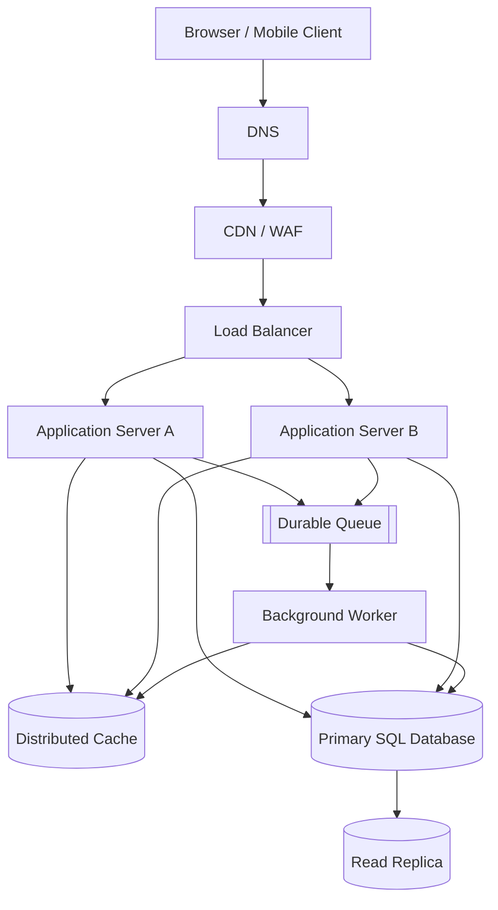

# QuickNotes System Architecture

## 1. Scope and requirements

### Functional requirements

1. Register and authenticate users.
2. Create, read, update, and delete notes.
3. List notes with pagination and optional tag filtering.
4. Create/list tags and attach or detach tags from notes.
5. Enforce ownership and validate titles and request payloads.
6. Return consistent success and error responses.

### Non-functional requirements

- **Scale:** support 1 million registered users with horizontal application scaling.
- **Availability:** target 99.9% monthly availability, subject to operational budget and agreed service-level objectives.
- **Performance:** target p95 read latency below 300 ms and write latency below 500 ms under normal load.
- **Security:** HTTPS, hashed passwords, access control, rate limiting, secrets management, and audit logs.
- **Durability:** automated backups, point-in-time recovery, and tested restoration procedures.
- **Observability:** centralized logs, metrics, traces, alerts, and health checks.
- **Maintainability:** stateless application servers, automated tests, versioned APIs, and repeatable deployments.

## 2. Planning estimates for 1 million users

These are initial capacity-planning assumptions, not measured production facts.

| Metric | Assumption | Estimate |
|---|---|---:|
| Registered users | Total accounts | 1,000,000 |
| Daily active users | 10% of registered users | 100,000 |
| Requests per active user | 50 requests/day | 5,000,000 requests/day |
| Read/write split | 90% reads, 10% writes | 4,500,000 reads/day; 500,000 writes/day |
| Average reads per second | 4,500,000 / 86,400 | about 52 reads/s |
| Average writes per second | 500,000 / 86,400 | about 6 writes/s |
| Peak planning factor | 10× daily average | about 521 reads/s; 58 writes/s |
| Stored notes | 100 notes/user, on average | 100 million notes |
| Average stored note | 2 KB of title/body and row data, before indexes/replicas | about 200 GB |
| New note data per year | 500,000 writes/day × 2 KB × 365 | about 365 GB/year |

Storage excludes indexes, WAL, backups, replicas, tags, and operational overhead. With indexes and replicas, provision more than the raw estimate (for example, start capacity modelling at 2–3× raw data), then adjust using measured data. The write estimate treats each write request as creating or changing a note; actual request mixes may differ. Capacity tests should validate peak concurrency and database connection limits.

## 3. Architecture diagram

## 4. What each component solves

- **Client:** provides the user interface and sends HTTPS requests; it never connects directly to the database.
- **DNS:** maps the API hostname to the edge entry point and supports managed routing changes.
- **CDN/WAF:** caches eligible static assets, filters common malicious traffic, and reduces edge latency; authenticated private note data must not be publicly cached.
- **Load balancer:** distributes requests across healthy application servers and removes unhealthy instances from rotation.
- **Application servers A and B:** run the stateless API, authentication, validation, authorization, and business logic; multiple instances allow horizontal scaling.
- **Distributed cache:** reduces repeated reads for safe, cacheable data; use short TTLs and invalidate affected keys after writes.
- **Primary SQL database:** provides durable transactional writes and enforces relational constraints.
- **Read replica:** serves eligible read traffic and reduces load on the primary; replication lag means it may briefly return stale data.
- **Durable queue:** buffers asynchronous work and separates user-facing requests from slower side effects.
- **Background worker:** processes queued tasks such as notifications, cleanup, or search indexing with retries and idempotency.

## 5. GET `/v1/notes` request flow

1. The client sends an HTTPS request with a valid access token and pagination parameters.
2. DNS resolves the API hostname; the CDN/WAF applies edge protections and forwards the dynamic API request.
3. The load balancer routes the request to a healthy application server.
4. The application validates the token, derives the user ID from trusted authentication context, and validates `limit`, `cursor`, and filters.
5. The application checks the cache for a suitable user-scoped result. Cache keys must include the user and relevant query parameters.
6. On a cache miss, the application reads the user's notes from the read replica when replica freshness is acceptable; otherwise it uses the primary.
7. The application returns `200 OK`, a `data` array, and pagination metadata. Empty results return an empty array.
8. The application records latency and outcome metrics. Cache entries are kept briefly and invalidated or versioned when notes change.

## 6. POST `/v1/notes` request flow

1. The client sends an HTTPS POST with its access token and JSON note fields.
2. DNS, CDN/WAF, and load balancer route the request to a healthy application server.
3. The application authenticates the user, validates the title/body and request size, and ignores any client-supplied ownership field.
4. The application writes the note to the primary database using a parameterized statement and transaction.
5. The database commits and returns the generated note ID and timestamps.
6. The application invalidates or versions affected cache entries so stale note lists are not served for long.
7. If asynchronous side effects are needed, the application publishes an event using a transactional outbox or another reliable delivery pattern; a worker processes it idempotently.
8. The API returns `201 Created` with the created note. A queue outage should not silently lose required work; durable outbox records can be retried.

## 7. Trade-offs

### SQL consistency vs. NoSQL flexibility

**Choice:** PostgreSQL for core note data. It gives strong transactions, foreign keys, unique constraints, and joins for users, notes, tags, and their associations. The trade-off is that schema migrations and write scaling require planning; indexes and query plans must be monitored. A NoSQL store could suit highly variable documents or particular high-volume access patterns, but would shift more relationship integrity into application code.

### Cache speed vs. freshness

**Choice:** use a distributed cache for high-repeat reads, not as the source of truth. It lowers database load and latency but introduces invalidation complexity and possible stale reads. Use short TTLs, user-scoped keys, explicit invalidation/versioning, and primary reads for operations requiring read-after-write consistency.

### Read replicas vs. immediate consistency

**Choice:** offload eligible list/read traffic to a replica. Replicas improve read capacity but may lag behind the primary. Route freshness-sensitive reads to the primary and monitor replication lag.

### Synchronous work vs. queues

**Choice:** keep the user-facing note write short and move optional slow side effects to a durable queue. This improves response time and absorbs bursts, but adds eventual consistency, retries, duplicate-delivery risks, and operational complexity. Workers must be idempotent, and failed messages need retry limits and a dead-letter queue.

## 8. Avoiding single points of failure

- Run at least two application servers across separate availability zones behind a health-checking load balancer; replace unhealthy instances automatically.
- Use a highly available managed database deployment with automated failover, backups, and point-in-time recovery; the read replica alone is not a substitute for a tested failover plan.
- Deploy the cache and queue in highly available configurations and define graceful degradation when they are unavailable.
- Use redundant DNS and CDN/WAF providers or managed multi-zone services where the availability target and budget justify them.
- Monitor database replication lag, queue depth, error rates, latency, and dependency health; rehearse restoration and failover.
